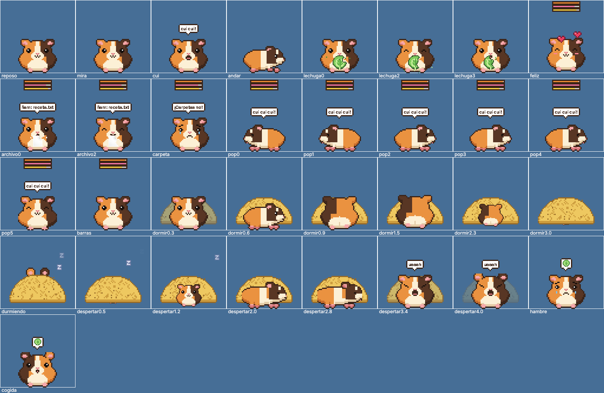

# Tamacuychi para PC

La cobaya del Tamacuychi, ahora viviendo en el escritorio del ordenador. Anda por
encima de la barra de tareas, hace "cui", se come los archivos que le das (los
manda a la papelera), hace *popcorning* por la pantalla cuando la tocas y deja
cacas que hay que recoger.

Funciona en **Windows** (el objetivo principal), macOS y Linux (X11).



## Instalar en Windows

1. Ve a **[Releases](https://github.com/Wazoskitekus/Cobayadeescritorio/releases/latest)**.
2. Descarga **`Tamacuychi-instalador-X.Y.Z.exe`** y ábrelo.
3. Si aparece "Windows protegió su PC", pulsa **Más información → Ejecutar de todas formas**
   (sale porque el programa no está firmado digitalmente).
4. Elige si quieres acceso directo en el escritorio y que aparezca al encender el ordenador.

No pide permisos de administrador: se instala en `%LOCALAPPDATA%\Programs\Tamacuychi`
y se desinstala desde *Configuración → Aplicaciones*. Si no quieres instalar nada,
descarga **`Tamacuychi-portable.exe`**, que funciona con doble clic.

Los .exe los compila GitHub Actions (`.github/workflows/windows.yml`) en cada
cambio de `main` y los publica en Releases con la versión de
`tamacuychi/__init__.py`. Para sacar una versión nueva, sube ese número
(por ejemplo a `1.0.1`); si no cambia, se actualizan los archivos de la misma Release.

## Arrancar desde el código

Doble clic en `iniciar.bat` (Windows), o:

```bash
pip install -r requirements.txt
```

```bash
python tamacuychi.pyw
```

Para crear el instalador en tu PC: `construir_exe.bat` y después
`iscc instalador.iss` ([Inno Setup 6](https://jrsoftware.org/isinfo.php)).

Para probar con el tiempo acelerado (1 minuto por segundo):

```bash
python tamacuychi.pyw --rapido
```

## Qué se puede hacer con ella

| Acción | Qué pasa |
|---|---|
| **Clic** sobre ella | *Popcorning*: de 4 a 8 saltos de distinta altura por la pantalla, girándose en el aire (+15 felicidad, −6 energía, −3 saciedad). Si está muy cansada, no juega. |
| **Arrastrar** un archivo y soltarlo encima | Abre la boca al olerlo y **se lo come**: mordiscos al icono del archivo, migas y "ñam". El archivo va a la **papelera** (se puede recuperar). Llena más cuanto más grande es (de +8 a +30 de saciedad). |
| **Pasar el ratón** por encima de un lado a otro | Caricia: corazones (+8 felicidad). |
| **Cogerla** (pulsar y mover) | La levantas; al soltarla cae con gravedad y rebota. Se puede lanzar. |
| Clic en una **caca** | La recoge con destellos (+2 felicidad). |
| Clic en el **bocadillo de lechuga** | Le das lechuga (+25 saciedad). |
| Clic mientras **duerme** | Se despierta: sale del heno, se estira y bosteza. |
| **Clic derecho** (o el icono de la bandeja) | Menú: lechuga, dormir/despertar, jugar, cui, recoger cacas, "ven aquí", tamaño, sonido, iniciar con Windows y salir. |

Al pasar el ratón por encima aparecen tres barras: saciedad (naranja), felicidad
(rosa) y energía (amarilla). Parpadean en rojo por debajo del 30 %.

### Qué no se come (por seguridad)

Nunca borra nada para siempre. Si no puede mandarlo a la papelera, no se lo come
y pone cara triste:

- **Carpetas**: "¡Carpetas no!"
- Archivos de más de **2 GB** (pueden no caber en la papelera): "¡Es enorme!"
- En Windows, archivos de **memorias USB o unidades de red**, que no tienen papelera: "De ahí no como".
- Si Windows no deja moverlo (archivo abierto, permisos...): "No puedo morderlo".

Al soltar, el programa siempre le dice al Explorador "copiar", nunca "mover",
para que el Explorador no borre el original por su cuenta.

## Comportamiento propio

Igual que en el firmware:

- **Desgaste**: la saciedad se vacía en 10 h, la felicidad en 8 h (el doble de rápido con hambre y un 50 % más por cada caca) y la energía en 14 h despierta. Durmiendo recarga en 3 h y se despierta sola.
- El tiempo con el programa cerrado también cuenta (hasta 12 h).
- **Cacas**: una cada 30–60 min y otra 10–20 min después de comer, como mucho 4, en el suelo a su lado, con líneas de olor.
- **Descuidada** (saciedad < 25, felicidad < 30 o 3 cacas o más): cara triste y anda más despacio. Con hambre pide lechuga con un bocadillo.
- **Cui**: de 1 a 3 silbidos que suben de tono, con bocadillo "cui!". Cada 1–3 min, o cada 15–35 s si tiene hambre.
- **Anda** sola de un lado a otro por encima de la barra de tareas, mira a los lados y parpadea.
- Muy contenta, a veces hace *popcorning* sola.
- Con la energía por debajo de 15 se va a dormir sola.
- **Dormir**: aparece el heno, se da la vuelta (frente, perfil, espaldas), camina hacia él haciéndose pequeña y se mete dentro; el heno respira, asoman las orejas y salen zetas.

Se guarda todo en `%APPDATA%\Tamacuychi\estado.json` (Windows),
`~/Library/Application Support/Tamacuychi` (macOS) o `~/.config/Tamacuychi` (Linux).

## Estructura

```
tamacuychi.pyw          arranque (doble clic en Windows, sin consola)
tamacuychi/
  app.py                aplicación, bandeja del sistema, menús, iniciar con Windows
  ventana.py            la cobaya: estados, animaciones, ratón, arrastrar y soltar
  mascota.py            estadísticas, desgaste, cacas y guardado (sin Qt)
  papelera.py           comprobaciones y envío seguro a la papelera
  cacas.py              ventanitas de las cacas
  sonido.py             cui, bostezo, ñam... sintetizados a WAV
  arte.py               pixel art generado por código (sin Qt)
  sprites.py            escalado entero y nítido, PNG opcionales de sprites/
  config.py             rutas y velocidad del tiempo
herramientas/
  exportar_sprites.py   arte -> sprites_generados/*.png e icono.ico
sprites/                PNG que sustituyen al arte generado (opcional)
construir_exe.bat       crea dist\Tamacuychi\Tamacuychi.exe con PyInstaller
instalador.iss          instalador de Windows (Inno Setup)
iniciar.bat             arranca desde el código en Windows
.github/workflows/      compila el instalador y el portable en GitHub
```

## Retocar el arte

El dibujo está hecho por código en `tamacuychi/arte.py` (elipses sin suavizado
con contorno automático, ojos y boca como sellos de píxeles). Para retocarlo a mano:

```bash
python herramientas/exportar_sprites.py
```

Abre el PNG que quieras de `sprites_generados/` en Aseprite, edítalo y cópialo a
`sprites/` con el mismo nombre. El programa usa el de `sprites/` en lugar del
generado. Sirven también los PNG del firmware (`cobaya_idle@2.png`,
`cobaya_feliz@2.png`...): la cobaya se apoya por el centro de la fila de abajo,
así que no importa que midan distinto.


## Notas técnicas

- **Qt (PySide6)**: ventana sin marco, siempre encima, transparente píxel a píxel y
  fuera de la barra de tareas. En Windows y macOS los píxeles transparentes dejan
  pasar el ratón; en Linux X11 se usa una máscara con las zonas visibles.
- **Pixel art nítido**: escalado entero en píxeles físicos, también con Windows al 125 % o 150 %.
- **Sonido**: los WAV se generan la primera vez; en Windows se reproducen con `winsound`.
- **Papelera**: `Send2Trash` (en Windows con `pywin32`, que además se niega a
  borrar si el archivo no cabe en la papelera).
- **Wayland**: las ventanas no pueden moverse solas, así que en Linux se fuerza XWayland.
